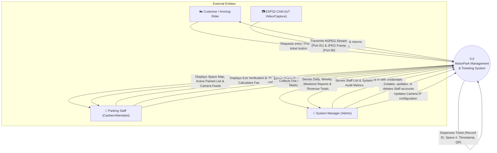
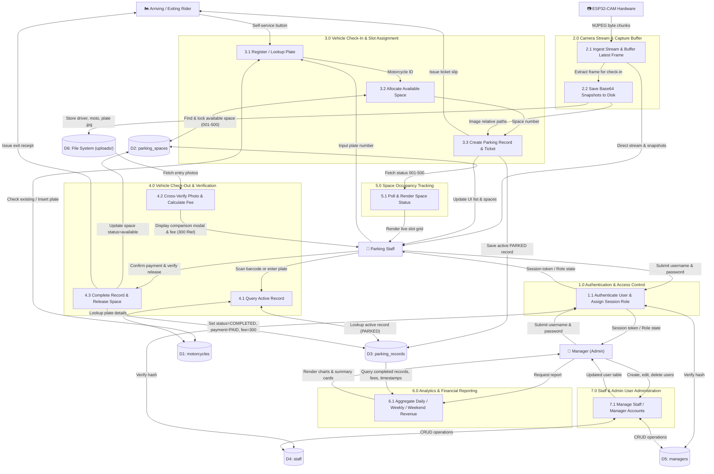
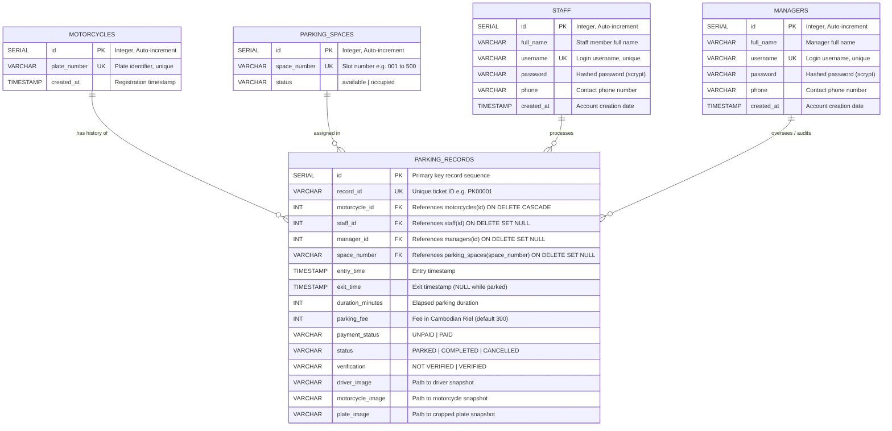

# MotorPark — Intelligent Motorcycle Parking Management System

A full-stack, IoT-integrated motorcycle parking management system featuring real-time space tracking, automated ticket dispensing, photo verification with ESP32-CAM, role-based access control (Staff/Manager), and financial analytics.

---

## Table of Contents
1. [System Description & Architecture](#1-system-description--architecture)
2. [Data Flow Diagrams (DFD)](#2-data-flow-diagrams-dfd)
   - [Context Diagram (Level 0 DFD)](#context-diagram-level-0-dfd)
   - [Detailed Data Flow Diagram (Level 1 DFD)](#detailed-data-flow-diagram-level-1-dfd)
3. [Entity-Relationship Diagram (ERD)](#3-entity-relationship-diagram-erd)
   - [Mermaid ER Diagram](#mermaid-er-diagram)
   - [Entities & Relationship Multiplicities](#entities--relationship-multiplicities)
4. [Database Normalization (1NF, 2NF, 3NF)](#4-database-normalization-1nf-2nf-3nf)
   - [Unnormalized Form (UNF)](#unnormalized-form-unf)
   - [First Normal Form (1NF)](#first-normal-form-1nf)
   - [Second Normal Form (2NF)](#second-normal-form-2nf)
   - [Third Normal Form (3NF)](#third-normal-form-3nf)
5. [Relationship Tables & Data Dictionary](#5-relationship-tables--data-dictionary)
6. [System Workflows & Modules](#6-system-workflows--modules)
7. [REST API Specification](#7-rest-api-specification)
8. [Installation & Setup Guide](#8-installation--setup-guide)

---

## 1. System Description & Architecture

### 1.1 Overview
**MotorPark** is an automated parking operations and security platform designed for commercial motorcycle parking facilities. The system bridges physical IoT camera hardware with a web-based management terminal, enabling high-throughput check-ins, automated slot allocation, theft prevention via dual-point photo verification, and financial reporting.

### 1.2 System Architecture
The application employs a layered client-server architecture:

```
+-------------------------------------------------------------------------+
|                              CLIENT LAYER                               |
|  +-----------------------------------+  +----------------------------+  |
|  |   Management Console (Browser)    |  |  Customer Kiosk (Browser)  |  |
|  | - Live Stream & Camera Snapshots  |  | - Self-service Check-In    |  |
|  | - Check-In / Check-Out Modals     |  | - Automated Ticket Print   |  |
|  | - History, Reports & Staff CRUD   |  | - 5-Second Auto-Reset      |  |
|  +-----------------------------------+  +----------------------------+  |
+-------------------------------------------------------------------------+
                                    │
                                HTTP/JSON
                                    │
+-------------------------------------------------------------------------+
|                        APPLICATION SERVER (Flask)                       |
|  +-------------------------------------------------------------------+  |
|  |  Flask REST API Backend (Port 5000)                               |  |
|  |  ├── Authentication & Session Guard (Werkzeug Scrypt Hash)        |  |
|  |  ├── Parking Controller (Check-in, Check-out, Space Allocator)    |  |
|  |  ├── Camera Stream Proxy & In-Memory Frame Buffer                 |  |
|  |  ├── Financial & Analytics Reporter (Daily, Weekly, Weekend)      |  |
|  |  └── Staff & Manager Account Administrator                        |  |
|  +-------------------------------------------------------------------+  |
+-------------------------------------------------------------------------+
              │                                             │
         psycopg2 / SQL                               HTTP / MJPEG
              │                                             │
+───────────────────────────+                 +───────────────────────────+
|   DATABASE (PostgreSQL)   |                 |    HARDWARE / IoT LAYER   |
| - motorcycles             |                 |  AI-Thinker ESP32-CAM     |
| - parking_spaces          |                 |  ├── Port 81: MJPEG Video |
| - parking_records         |                 |  └── Port 80: JPEG Snap   |
| - staff                   |                 +───────────────────────────+
| - managers                |
| + Local Disk Storage:     |
|   uploads/parking/<id>/   |
+───────────────────────────+
```

### 1.3 Key Technologies
- **Frontend**: Single Page Application (SPA) built with HTML5, Vanilla CSS3 (Glassmorphic dark/light UI tokens, responsive CSS grid), and JavaScript ES6+ (Fetch API, Canvas snapshot generator, live clock, QR code renderer).
- **Backend**: Python 3 with Flask micro-framework, CORS support, session cookie security, and multi-threaded dual-window browser launcher.
- **Database**: PostgreSQL 16+ via `psycopg2`, utilizing foreign key relational integrity, cascading deletes, timestamping, and indexed queries.
- **Image Storage**: Hybrid database-filesystem architecture where image binary files are stored on disk (`uploads/parking/<record_id>/`) and static relative paths are referenced in relational records.
- **IoT Hardware**: AI Thinker ESP32-CAM running an Arduino-based MJPEG video streaming server with continuous ring-buffer frame caching in Flask.

---

## 2. Data Flow Diagrams (DFD)

### Context Diagram (Level 0 DFD)

The Context Diagram defines the system boundary, external entities, and high-level data flows into and out of **MotorPark**.



---

### Detailed Data Flow Diagram (Level 1 DFD)

The Level 1 DFD decomposes the system into seven primary functional processes and six data stores.



---

## 3. Entity-Relationship Diagram (ERD)

### Mermaid ER Diagram

The following diagram models the entities, primary keys (`PK`), foreign keys (`FK`), attributes, data types, and cardinality constraints as implemented in PostgreSQL:



### Entities & Relationship Multiplicities

| Relationship | Cardinality | Business Rule Description |
| :--- | :---: | :--- |
| **MOTORCYCLES to PARKING_RECORDS** | `1 : N` (Zero or Many) | A motorcycle can visit the facility multiple times, generating multiple historical parking records. Each parking record corresponds to exactly one physical motorcycle. |
| **PARKING_SPACES to PARKING_RECORDS** | `1 : N` (Zero or Many) | A designated parking space (e.g., Space `005`) accumulates multiple parking records over time, but can only have **one** record with `status = 'PARKED'` at any given moment. |
| **STAFF to PARKING_RECORDS** | `1 : N` (Zero or Many) | A parking employee/cashier handles many check-in and check-out transactions. If a staff account is deleted, foreign keys are set to `NULL` to preserve audit records. |
| **MANAGERS to PARKING_RECORDS** | `1 : N` (Zero or Many) | A system manager oversees administrative actions, overrides, and audit checks across parking records. |

---

## 4. Database Normalization (1NF, 2NF, 3NF)

Normalization organizes database columns and tables to eliminate data redundancy and avoid update, insertion, and deletion anomalies.

---

### Unnormalized Form (UNF)
In an unnormalized state, parking data is stored as a single flat transaction record or physical ticket document containing repeated data, non-atomic attributes, and mixed business concepts:

```
PARKING_TRANSACTION_UNF:
[
  RecordID,
  PlateNumber,
  MotorcycleDetails,
  SpaceNumber,
  SpaceStatus,
  EntryTimestamp,
  ExitTimestamp,
  DurationMinutes,
  ParkingFee,
  PaymentStatus,
  RecordStatus,
  VerificationStatus,
  DriverImagePath,
  MotorcycleImagePath,
  PlateImagePath,
  StaffUsername,
  StaffFullName,
  StaffPhone,
  StaffPassword,
  ManagerUsername,
  ManagerFullName,
  ManagerPhone
]
```

**Anomalies in UNF:**
- **Redundancy**: Repeating staff and manager personal details on every single ticket created.
- **Update Anomaly**: If a staff member changes their phone number, thousands of historical records must be updated.
- **Deletion Anomaly**: Deleting a parking record would delete the only reference to a motorcycle or staff member.

---

### First Normal Form (1NF)

**Rules for 1NF:**
1. All attributes must be atomic (indivisible single values).
2. No repeating groups or multivalued attributes.
3. A unique primary key must be defined.

To achieve 1NF:
- Decompose compound fields (e.g., individual image paths are stored as separate atomic columns: `driver_image`, `motorcycle_image`, `plate_image`).
- Define the composite primary key candidates: `(record_id, plate_number)`.

```
FLAT_1NF_RELATION (
    record_id (PK),
    plate_number (PK),
    space_number,
    space_status,
    entry_time,
    exit_time,
    duration_minutes,
    parking_fee,
    payment_status,
    record_status,
    verification,
    driver_image,
    motorcycle_image,
    plate_image,
    staff_username,
    staff_full_name,
    staff_phone,
    manager_username,
    manager_full_name
)
```

**Functional Dependencies (FDs) in 1NF:**
- `record_id -> space_number, entry_time, exit_time, duration_minutes, parking_fee, payment_status, record_status, verification, driver_image, motorcycle_image, plate_image`
- `plate_number -> (motorcycle attributes)`
- `staff_username -> staff_full_name, staff_phone`
- `manager_username -> manager_full_name`

**1NF Violation Identified:**
There are **Partial Functional Dependencies** where non-key attributes depend on only a portion of the composite key (`plate_number`), violating 2NF.

---

### Second Normal Form (2NF)

**Rules for 2NF:**
1. Must be in 1NF.
2. Must eliminate **Partial Functional Dependencies**: all non-key attributes must be fully functionally dependent on the **entire** primary key.

To achieve 2NF, we separate entities into distinct tables based on what their attributes functionally depend upon:

1. **`motorcycles`**: Attributes that depend strictly on the vehicle's unique identity:
   - Primary Key: `id` (or `plate_number`)
   - Dependent attributes: `plate_number`, `created_at`
2. **`parking_spaces`**: Attributes describing the facility slot:
   - Primary Key: `space_number`
   - Dependent attributes: `status`
3. **`staff`**: Staff profile details:
   - Primary Key: `id` (or `username`)
   - Dependent attributes: `full_name`, `password`, `phone`, `created_at`
4. **`managers`**: Manager profile details:
   - Primary Key: `id` (or `username`)
   - Dependent attributes: `full_name`, `password`, `phone`, `created_at`
5. **`parking_records`**: Attributes dependent on the parking transaction:
   - Primary Key: `record_id` (or `id`)
   - Foreign Keys: `motorcycle_id`, `space_number`, `staff_id`, `manager_id`
   - Dependent attributes: `entry_time`, `exit_time`, `duration_minutes`, `parking_fee`, `payment_status`, `status`, `verification`, image paths.

**Remaining Issue in 2NF:**
Checking for **Transitive Dependencies** where non-prime attributes depend on other non-prime attributes (`X -> Y -> Z`).

---

### Third Normal Form (3NF)

**Rules for 3NF:**
1. Must be in 2NF.
2. Must eliminate **Transitive Functional Dependencies**: no non-prime attribute may depend on another non-prime attribute ($X \to Y$ must only exist if $X$ is a superkey or $Y$ is a prime attribute).

In our schema:
- In `parking_records`, staff and manager names/phones do not reside in the table; only the surrogate foreign keys `staff_id` and `manager_id` are stored.
- In `parking_records`, motorcycle plate details do not reside in the table; only `motorcycle_id` is stored as an FK.
- In `parking_records`, space operational state (`status = 'available'`) is stored in `parking_spaces`, not duplicated in the record.

#### Final 3NF Normalized Relations:

$$\text{MOTORCYCLES}(\underline{\text{id}}, \text{plate\_number}, \text{created\_at})$$

$$\text{PARKING\_SPACES}(\underline{\text{id}}, \text{space\_number}, \text{status})$$

$$\text{STAFF}(\underline{\text{id}}, \text{full\_name}, \text{username}, \text{password}, \text{phone}, \text{created\_at})$$

$$\text{MANAGERS}(\underline{\text{id}}, \text{full\_name}, \text{username}, \text{password}, \text{phone}, \text{created\_at})$$

$$\text{PARKING\_RECORDS}(\underline{\text{id}}, \text{record\_id}, \text{motorcycle\_id}^*, \text{staff\_id}^*, \text{manager\_id}^*, \text{space\_number}^*, \text{entry\_time}, \text{exit\_time}, \text{duration\_minutes}, \text{parking\_fee}, \text{payment\_status}, \text{status}, \text{verification}, \text{driver\_image}, \text{motorcycle\_image}, \text{plate\_image})$$

*(Asterisks indicate foreign keys)*

---

## 5. Relationship Tables & Data Dictionary

### Table 1: `motorcycles`
Stores unique vehicle records registered in the facility.

| Column Name | Data Type | Constraints | Nullable | Description |
| :--- | :--- | :--- | :---: | :--- |
| `id` | `SERIAL` | **PRIMARY KEY** | NO | Surrogate auto-increment vehicle ID |
| `plate_number` | `VARCHAR(50)` | **UNIQUE** | NO | Official license plate string (e.g. `1AB-1234`) |
| `created_at` | `TIMESTAMP` | `DEFAULT CURRENT_TIMESTAMP` | NO | First system registration timestamp |

---

### Table 2: `parking_spaces`
Tracks physical slots within the parking area (Capacity: 500 slots).

| Column Name | Data Type | Constraints | Nullable | Description |
| :--- | :--- | :--- | :---: | :--- |
| `id` | `SERIAL` | **PRIMARY KEY** | NO | Surrogate auto-increment slot ID |
| `space_number` | `VARCHAR(10)` | **UNIQUE** | NO | Slot label (`001` through `500`) |
| `status` | `VARCHAR(20)` | `DEFAULT 'available'` | NO | Slot availability (`available`, `occupied`) |

---

### Table 3: `staff`
Stores employee accounts (Cashiers, Gate Attendants).

| Column Name | Data Type | Constraints | Nullable | Description |
| :--- | :--- | :--- | :---: | :--- |
| `id` | `SERIAL` | **PRIMARY KEY** | NO | Staff identification number |
| `full_name` | `VARCHAR(100)` | — | NO | Staff member's legal name |
| `username` | `VARCHAR(50)` | **UNIQUE** | NO | Login credential handle |
| `password` | `VARCHAR(255)` | — | NO | Password hashed via Scrypt (`werkzeug.security`) |
| `phone` | `VARCHAR(30)` | — | YES | Contact mobile number |
| `created_at` | `TIMESTAMP` | `DEFAULT CURRENT_TIMESTAMP` | NO | Account creation timestamp |

---

### Table 4: `managers`
Stores high-privilege administrative accounts with access to reports and staff CRUD.

| Column Name | Data Type | Constraints | Nullable | Description |
| :--- | :--- | :--- | :---: | :--- |
| `id` | `SERIAL` | **PRIMARY KEY** | NO | Manager identification number |
| `full_name` | `VARCHAR(100)` | — | NO | Administrator full name |
| `username` | `VARCHAR(50)` | **UNIQUE** | NO | Login credential handle |
| `password` | `VARCHAR(255)` | — | NO | Password hashed via Scrypt |
| `phone` | `VARCHAR(30)` | — | YES | Contact mobile number |
| `created_at` | `TIMESTAMP` | `DEFAULT CURRENT_TIMESTAMP` | NO | Account creation timestamp |

---

### Table 5: `parking_records`
The central operational transaction table recording vehicle visits, fees, and photo proofs.

| Column Name | Data Type | Constraints / Foreign Keys | Nullable | Description |
| :--- | :--- | :--- | :---: | :--- |
| `id` | `SERIAL` | **PRIMARY KEY** | NO | Auto-increment transaction sequence |
| `record_id` | `VARCHAR(30)` | **UNIQUE** | YES | Business ticket reference (e.g. `PK00001`) |
| `motorcycle_id`| `INT` | **FK** -> `motorcycles(id)` `ON DELETE CASCADE` | NO | Reference to vehicle entity |
| `staff_id` | `INT` | **FK** -> `staff(id)` `ON DELETE SET NULL` | YES | Attendant who handled check-in/out |
| `manager_id` | `INT` | **FK** -> `managers(id)` `ON DELETE SET NULL` | YES | Manager overseeing record (if applicable) |
| `space_number` | `VARCHAR(10)` | **FK** -> `parking_spaces(space_number)` `ON DELETE SET NULL` | YES | Allocated slot identifier |
| `entry_time` | `TIMESTAMP` | `DEFAULT CURRENT_TIMESTAMP` | NO | Exact timestamp when vehicle entered |
| `exit_time` | `TIMESTAMP` | — | YES | Exact timestamp when vehicle checked out |
| `duration_minutes` | `INT` | — | YES | Total duration parked (minutes) |
| `parking_fee` | `INT` | `DEFAULT 0` | YES | Collected fee in Cambodian Riel (standard 300) |
| `payment_status` | `VARCHAR(30)` | `DEFAULT 'UNPAID'` | NO | `UNPAID` or `PAID` |
| `status` | `VARCHAR(30)` | `DEFAULT 'PARKED'` | NO | Operational status (`PARKED`, `COMPLETED`) |
| `verification`| `VARCHAR(30)` | `DEFAULT 'NOT VERIFIED'`| YES | Visual photo validation status |
| `driver_image`| `VARCHAR(255)`| — | YES | Disk path to driver snapshot image |
| `motorcycle_image` | `VARCHAR(255)`| — | YES | Disk path to motorcycle snapshot image |
| `plate_image` | `VARCHAR(255)`| — | YES | Disk path to cropped plate image |

---

## 6. System Workflows & Modules

### 6.1 Dual-Window Operating Workflow
When launched via `run_app.bat` or `python backend/app.py`, the system automatically opens two browser windows:
1. **Window 1 — Management Console (`http://127.0.0.1:5000/`)**: Secure dashboard for parking attendants and managers containing check-in, check-out, live camera stream, history table, and reports.
2. **Window 2 — Customer Kiosk Screen (`http://127.0.0.1:5000/kiosk`)**: Clean touch-friendly interface for arriving riders. Riders tap **"Print Entry Ticket"**, triggering camera capture, automatic slot assignment, and thermal ticket printing. The interface auto-resets to standby after 5 seconds.

### 6.2 Check-In Workflow
1. Rider arrives at the entry gate.
2. Staff types the plate number (or customer uses self-service kiosk).
3. System fetches the live camera snapshot from the ESP32-CAM (or in-memory cache).
4. System finds the first `available` parking slot (e.g. `001`) from `parking_spaces`.
5. Inserts or fetches the motorcycle in `motorcycles`.
6. Saves captured images to `uploads/parking/PK0000X/`.
7. Inserts `parking_records` with `status = 'PARKED'`, `parking_fee = 300`, and `payment_status = 'UNPAID'`.
8. Updates the parking space to `occupied`.
9. Generates a physical/digital ticket containing Record ID, Slot #, Date/Time, and QR code.

### 6.3 Check-Out & Photo Verification Workflow
1. Rider presents ticket or plate number at exit cashier.
2. Staff enters Ticket ID or Plate in the Check-Out modal.
3. System queries `parking_records` where `status = 'PARKED'`.
4. System calculates elapsed duration (`exit_time - entry_time`) and fee (300 Riel).
5. Verification modal displays the **entry photos** (driver face, motorcycle, license plate).
6. Staff compares the photos against the actual exiting rider for theft prevention.
7. Upon clicking **"Confirm & Collect Fee"**:
   - `parking_records.status` is set to `'COMPLETED'`.
   - `parking_records.payment_status` is set to `'PAID'`.
   - `parking_spaces.status` is updated to `'available'`.
   - A stamped receipt is generated.

### 6.4 Role-Based Access Control (RBAC) Matrix

| Feature / Endpoint | Public / Kiosk | Parking Employee (Staff) | Manager (Admin) |
| :--- | :---: | :---: | :---: |
| Kiosk Self-Service Check-In (`/kiosk`) |  Yes |  Yes |  Yes |
| Dashboard & Executive Analytics | No | No |  Yes |
| Attendant Check-In & Check-Out | No |  Yes | No (Removed) |
| Live Camera Streaming & Snapshot Capture | No |  Yes |  Yes |
| Parking History Search & Filtering | No |  Yes |  Yes |
| Cashier Shift Report & Change Calculator | No |  Yes | No |
| All-Time Financial Overview & Staff Breakdown | No | No |  Yes |
| Financial Statement CSV Export | No | No |  Yes |
| Employee & Manager CRUD (`/api/users`) | No | No |  Yes |
| ESP32-CAM IP Configuration | No | No |  Yes |

---

## 7. REST API Specification

### Authentication Endpoints
| Method | Endpoint | Access | Description |
| :--- | :--- | :---: | :--- |
| `POST` | `/api/auth/login` | Public | Authenticates username/password against `managers` and `staff` tables. |
| `POST` | `/api/auth/logout` | Session | Clears session cookie. |
| `GET` | `/api/auth/status` | Public | Returns current logged-in user details and role. |

### Parking Operations
| Method | Endpoint | Access | Description |
| :--- | :--- | :---: | :--- |
| `GET` | `/api/health` | Public | Database and service status check. |
| `GET` | `/api/spaces` | Public | Retrieves all 20 parking spaces and statuses (`available`/`occupied`). |
| `GET` | `/api/records` | Public | Lists all parking records with joined plate and staff details. |
| `POST` | `/api/check-in` | Public | Creates parking record, allocates space, and stores base64 images. |
| `POST` | `/api/check-out` | Public | Completes session, calculates duration, releases space, sets fee=300. |

### Camera & IoT Integration
| Method | Endpoint | Access | Description |
| :--- | :--- | :---: | :--- |
| `GET` | `/api/camera/stream` | Public | Proxies multipart MJPEG video stream from ESP32-CAM (`:81/stream`). |
| `GET` | `/api/camera/snapshot` | Public | Returns base64 JPEG snapshot from active stream buffer or direct `/capture`. |
| `GET` | `/api/camera/status` | Public | Tests ping latency and connection state to ESP32-CAM. |
| `GET` | `/api/camera-config` | Public | Gets configured ESP32-CAM IP address. |
| `POST` | `/api/camera-config` | Public | Updates ESP32-CAM IP address in `camera_config.json`. |

### Financial Reports & Shift Auditing
| Method | Endpoint | Access | Description |
| :--- | :--- | :---: | :--- |
| `GET` | `/api/manager/financial-overview` | Manager | All-time gross revenue, monthly totals, and staff collection breakdown table. |
| `GET` | `/api/staff/shift-summary` | Staff/Mgr | Current cashier shift total, cash drawer amount to hand over, and ticket volume. |
| `GET` | `/api/daily-report` | Public/Mgr | Today's check-ins, completed exits, and total collected Riel. |
| `GET` | `/api/weekly-report` | Public/Mgr | 7-day total completed motorcycles and revenue. |
| `GET` | `/api/weekly-breakdown`| Public/Mgr | Daily day-by-day revenue breakdown for the past 7 days. |
| `GET` | `/api/weekend-report`| Public/Mgr | Weekend (Saturday/Sunday) throughput and revenue. |

### User Administration (Manager Only)
| Method | Endpoint | Access | Description |
| :--- | :--- | :---: | :--- |
| `GET` | `/api/users` | Manager | Lists all managers and staff members. |
| `POST` | `/api/users` | Manager | Creates a new staff or manager account with hashed password. |
| `PUT` | `/api/users/<id>` | Manager | Updates full name, role, phone, or password. |
| `DELETE`| `/api/users/<id>` | Manager | Deletes staff or manager account (prevents deleting primary admin). |

---

## 8. Installation & Setup Guide

### 8.1 Prerequisites
- **Python**: Version 3.10 or higher.
- **PostgreSQL**: Version 14 or higher (listening on port `5433` or configured port).
- **Web Browser**: Google Chrome, Microsoft Edge, or Firefox.
- **Hardware (Optional)**: AI Thinker ESP32-CAM module connected to local Wi-Fi.

### 8.2 Database Configuration
1. Open pgAdmin or `psql` and create the database:
   ```sql
   CREATE DATABASE motorpark;
   ```
2. Execute the schema script located at `backend/database.sql` to generate all tables, default manager (`admin` / `admin123`), and default staff (`cashier` / `cashier123`).

### 8.3 Environment Variables
Configure your database credentials in `backend/.env`:
```env
PGHOST=127.0.0.1
PGPORT=5433
PGDATABASE=motorpark
PGUSER=postgres
PGPASSWORD=123456789
PORT=5000
SECRET_KEY=motorpark_secret_key_prod_9876
ESP32_CAM_IP=172.20.10.12
```

### 8.4 Quick Start
Run the system using the root batch script:
```powershell
.\run_app.bat
```

Or manually via terminal:
```powershell
# Activate virtual environment
.\.venv\Scripts\Activate.ps1

# Install requirements
pip install -r backend\requirements.txt

# Run backend
python backend\app.py
```

Upon launch, the backend will verify database tables, ensure seed records exist, and automatically launch both the **Management Console** and **Customer Kiosk** browser windows.
